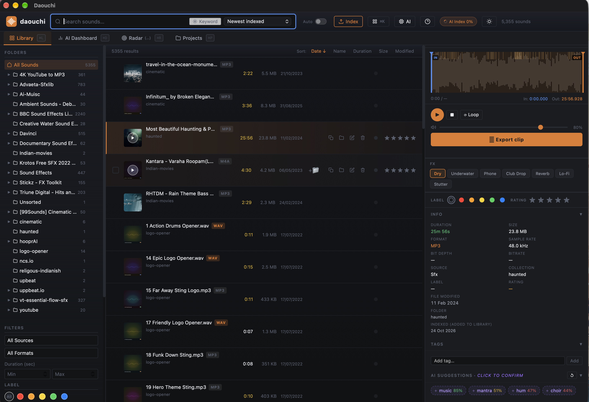

# Daouchi

Daouchi is a local-first desktop audio browser for video editors and vloggers. It indexes your sound-effect and music folders, lets you find sounds by keyword, filters or by describing them in plain language, previews them on a waveform, and exports a trimmed lossless clip you can drag straight into your editor.

Everything runs offline on your machine in a single process. Your audio files are never modified or uploaded; indexing only reads them.



Repository: https://github.com/sahilsk/Daouchi (`git@github.com:sahilsk/Daouchi.git`)

---

## Features

- **Indexing** of any number of folders (WAV, MP3, M4A, FLAC, AIFF) with live progress, throughput and ETA, and a safe cancel. Indexing is additive: it never deletes rows or touches your tags, favorites, ratings or projects.
- **Full-text search** (SQLite FTS5, prefix matching) across filename, folder, collection and tags, with facet filters (source, extension, duration, favorites, tags, tag bundles, rating, color label) and sorting.
- **Folder tree** sidebar for browsing by collection and sub-folder.
- **Waveform player** (WaveSurfer.js) with draggable in/out markers, loop region, J-K-L playback, and transient ticks that mark detected hits on the waveform.
- **Favorites, star ratings, color labels and tags**, including bulk tagging of a selection and named tag bundles.
- **AI semantic search**: describe a sound ("subtle outdoor rain") and get acoustically matching files (CLAP). Also a mood search (valence/arousal matrix), SFX categories (riser, impact, atmosphere, foley, whoosh) and "find similar".
- **Auto-tag suggestions** (Audio Spectrogram Transformer, cross-checked against CLAP). Suggestions are not searchable until you confirm them.
- **Acoustic radar**: a 2D UMAP map of your library where nearby dots sound alike; hover, lasso-select and click to load.
- **Export clip**: sample-exact, lossless WAV of the in/out region at the source sample rate and channel count, with optional FX presets, then reveal in Finder or drag the file out into any editor.
- **Projects**: named bins of sounds with per-row waveforms.
- **Offline by design**: the UI libraries are bundled; AI models are the only thing ever downloaded, and only when you first use a feature that needs them.

### Keyboard shortcuts

| Key | Action |
|---|---|
| `Space` | Play / pause |
| `L` / `J` | Forward / reverse playback (tap to cycle 1x, 2x, 4x) |
| `K` | Stop |
| `I` / `O` | Set in / out point |
| `Shift+I` / `Shift+O` | Move playhead to in / out point |
| `Option+X` | Clear both markers |
| `Enter` | Export clip |
| `Up` / `Down` | Navigate results |
| `Cmd+F` | Focus search |
| `Cmd+K` | Command palette |
| `?` | Shortcut overlay |

---

## Architecture

```
Tauri desktop window (webview)
  |  loads the UI from  daouchi://localhost/   (http://daouchi.localhost/ on Windows)
  v
Custom URI scheme handler            crates/daouchi-desktop
  |  in-process call, no socket
  v
axum Router                          src/ (library crate `daouchi`)
  |-- SQLite (rusqlite, FTS5)        ~/.daouchi/data/sounds.db
  |-- indexer (walkdir + rayon + symphonia)
  `-- AI engines                     crates/daouchi-ai
        ONNX Runtime (CoreML on macOS, CPU fallback): CLAP, AST
        UMAP (pure Rust), transient detection
```

The webview talks to the Rust core over a Tauri custom URI scheme; each request is converted to an HTTP request and run through the axum `Router` in the same process. The application opens no network port, so nothing else on the machine (including web pages in a browser) can reach its API, and the router has no CORS layer. Details are in [docs/ARCHITECTURE.md](docs/ARCHITECTURE.md); the HTTP contract is in [contracts.md](contracts.md).

---

## Storage

All application data lives under `~/.daouchi` (override with `DAOUCHI_HOME`), never in the repository:

```
~/.daouchi/                 (or $DAOUCHI_HOME)
  data/      sounds.db      SQLite database
  models/    <name>/        clap/, ast/ - model files + manifest.json
  cache/                    artwork, CoreML compiled-model cache
  exports/                  exported clips (lossless WAV)
  lib/                      optional location for libonnxruntime
```

### Models

The two AI models (CLAP for semantic search, mood, SFX categories and the radar; AST for auto-tag suggestions) are downloaded on demand the first time a feature needs them, with progress shown in the app. Each model folder contains a `manifest.json` listing every file with its size and sha256; files are verified before use and downloads are resumable.

- **Preseed** (no network needed): copy a complete model folder, including its `manifest.json`, to `~/.daouchi/models/<name>/` (`clap` or `ast`). It is treated as ready.
- **Delete**: remove the folder `~/.daouchi/models/<name>/`. The feature reports the model as missing until it is downloaded again.

Without a model the corresponding endpoints answer `409 model_not_ready`; the rest of the app keeps working.

---

## Requirements

- macOS on Apple Silicon (the first supported platform).
- Rust 1.91 or newer (`rustup`).
- ONNX Runtime **1.22.x** shared library (`libonnxruntime.dylib`). The app loads it dynamically, in this order: `$ORT_DYLIB_PATH`, `<exe dir>/../Frameworks`, `<exe dir>`, `~/.daouchi/lib/`. For development, put it at `~/.daouchi/lib/libonnxruntime.dylib` or point `ORT_DYLIB_PATH` at it. Without it the app starts but AI features report `503 engine_unavailable`.

## Build and run

```bash
./start.sh     # release build + launch the desktop app
./dev.sh       # debug build, UI served from web/ on disk (edit, then reload), RUST_LOG=debug
```

Both scripts build into `$HOME/.cache/daouchi-target` by default and pick up `~/.daouchi/lib/libonnxruntime.dylib` if present. Environment variables:

| Variable | Purpose |
|---|---|
| `CARGO_TARGET_DIR` | Build output location (default in the scripts: `~/.cache/daouchi-target`) |
| `ORT_DYLIB_PATH` | Path to the ONNX Runtime shared library |
| `DAOUCHI_HOME` | Relocate the data directory (default `~/.daouchi`) |
| `DAOUCHI_WEB_DIR` | Serve the UI from this directory instead of the embedded copy (`dev.sh` sets it to `web/`) |
| `RUST_LOG` | Log filter, e.g. `RUST_LOG=daouchi=debug` |

Equivalent manual command: `cargo run --release -p daouchi-desktop`.

## Tests

```bash
cargo check --workspace
cargo test --workspace --lib                 # unit tests, no models needed
cargo test -p daouchi-ai                     # also runs golden tests; those needing models skip without them
```

Golden tests compare the Rust pipelines against numeric reference outputs (CLAP mel/embeddings, AST fbank/probabilities, librosa onset detection). The test signals are synthesized in code (no audio files are stored in the repository); the fixtures hold reference outputs only. The model-backed ones need a model directory and ONNX Runtime:

```bash
DAOUCHI_TEST_MODELS=/path/to/models cargo test -p daouchi-ai
```

Set `DAOUCHI_TEST_COREML=1` to also run the opt-in CoreML tests. `DAOUCHI_TEST_MODELS` is a directory holding `ast/` (a `model.onnx`, directly or under `onnx/`) and the CLAP files (`audio_model.onnx`, `text_model.onnx`, `tokenizer.json`). The router-level integration test runs against a scratch home:

```bash
DAOUCHI_INTEG=1 DAOUCHI_HOME=/tmp/daouchi-integ cargo test -p daouchi integ -- --nocapture
# add DAOUCHI_INTEG_MODELS=1 when the models are preseeded in that home
```

## Packaging (macOS)

```bash
scripts/bundle-macos.sh [debug|release]      # default: release
```

Builds the desktop crate and assembles an unsigned `Daouchi.app` at `$CARGO_TARGET_DIR/bundle/macos/`, embedding the ONNX Runtime library in `Contents/Frameworks/`. Signing and notarization steps are in [docs/DESKTOP_PACKAGING.md](docs/DESKTOP_PACKAGING.md).

---

## Project layout

```
Cargo.toml                workspace: daouchi (lib), daouchi-ai, daouchi-desktop
schema.sql                SQLite schema reference
contracts.md              HTTP API contract
src/
  lib.rs                  build_app(): storage, DB, engines, Router
  transport.rs            custom-scheme request/response dispatch
  engines.rs              AI engine lifecycle, model downloads, radar job
  indexer.rs              parallel filesystem scan + metadata extraction
  lifecycle.rs            ~/.daouchi paths
  db.rs, db_migrate.rs    SQLite connection and versioned migrations
  api/                    route handlers (search, audio, metadata, index, models,
                          mood, export, radar, projects, stems, assets)
crates/
  daouchi-ai/             ONNX engines: CLAP, AST, fbank, UMAP, transients, model manager
  daouchi-desktop/        Tauri shell (scheme handler, drag-out, single instance)
web/                      Alpine.js UI (index.html, app.js, components/, vendor/)
docs/                     ARCHITECTURE, DESKTOP_PACKAGING, THRESHOLD_TUNING
scripts/bundle-macos.sh   unsigned .app assembly
start.sh, dev.sh          run scripts
```

## Troubleshooting

- **AI features say the engine is unavailable (503):** ONNX Runtime 1.22.x was not found. Set `ORT_DYLIB_PATH` or place the library in `~/.daouchi/lib/`.
- **First semantic search or auto-tag is slow:** the first CoreML compile of a model takes about 2 minutes; the compiled result is cached under `~/.daouchi/cache/coreml/` and reused afterwards. If CoreML fails, the engine falls back to CPU automatically.
- **Offline:** everything works offline once the models are present. Without them, only the AI features are unavailable (409); preseed the model folders to avoid any network access.
- **Project on an exFAT drive:** macOS creates `._*` sidecar files there. They are git-ignored, and the embedded UI excludes them. Keep build output on an internal disk (the scripts default `CARGO_TARGET_DIR` accordingly).
- **A very large file (over 64 MiB) shows a waveform of its first 64 MiB only.** See the transport notes in [docs/ARCHITECTURE.md](docs/ARCHITECTURE.md).

## Roadmap

- Stem separation (the API reports `not_available` today).
- Windows and Linux builds.
- Library-relative paths and database sync across machines.
- Code signing and notarization of release builds.
- A precompiled Tailwind stylesheet in place of the in-browser compiler.

## License

Daouchi is released under the [MIT License](LICENSE). Third-party libraries and the models downloaded on demand keep their own licenses; see [THIRD_PARTY_NOTICES.md](THIRD_PARTY_NOTICES.md).
